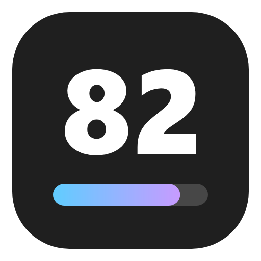
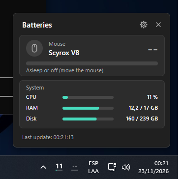
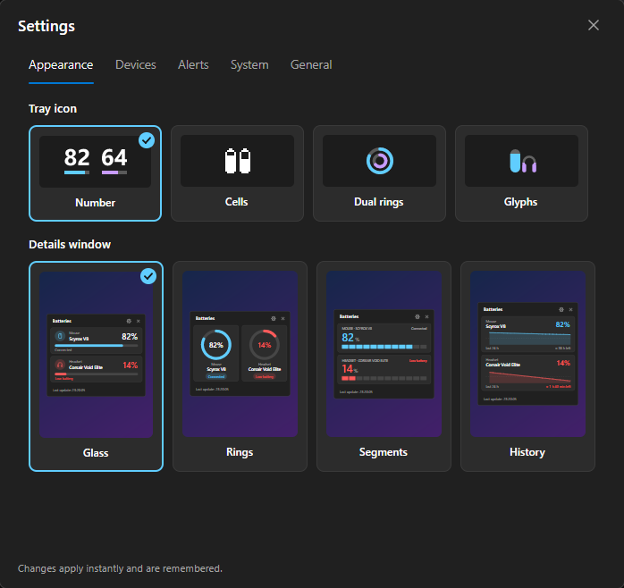

<div align="center">



# Juicebar

**Every battery you own, one glance away.**

Juicebar lives in your system tray and shows the charge of your wireless mouse, headset, keyboard and controllers, side by side with your CPU, RAM, disk and GPU. No vendor apps, no accounts, no cloud.

[](#-install)
[](https://dotnet.microsoft.com/)
[](https://avaloniaui.net/)
[](https://github.com/hydrxgenn-sv/Juicebar/releases/latest)
[](https://github.com/hydrxgenn-sv/Juicebar/actions/workflows/release.yml)
[](LICENSE)

[Features](#-features) · [Devices](#-supported-devices) · [Install](#-install) · [Usage](#-usage) · [Build](#-build-from-source) · [Contributing](#-adding-a-battery-source)

</div>

---

<p align="center">
  
</p>

## ✨ Features

| | |
|---|---|
| 🔋 **One icon per device** | Each peripheral gets its own tray icon: the percentage plus a bar in the device's color. It turns **red** when low, **green** while charging and **dims** when the device sleeps. |
| 🎨 **Four icon styles** | *Number*, *Cells*, *Dual rings* and *Glyphs* — the last three fit two devices into a single icon. |
| 🪟 **Four window styles** | *Glass*, *Rings*, *Segments* and *History*, the last with a 24-hour chart and an estimated time left. |
| 🖥️ **System monitor** | CPU, RAM, disk and GPU usage plus temperatures in the details window, and an optional tray icon for the metric you care about. |
| 🩺 **Battery health** | Estimated charge cycles, average drain per hour and how long a full charge really lasts, per device. |
| 🔔 **Smart alerts** | Low-battery threshold from 5 to 50 %, a "fully charged, unplug it" alert and an optional sound. |
| 🧩 **Desktop widget** | A compact, draggable list of your devices that remembers where you left it. Double-click to open the details. |
| ⌨️ **Keyboard shortcut** | `Ctrl+Alt+B` on Windows (falls back to `Ctrl+Alt+M` or `Ctrl+Shift+Alt+B` if taken). |
| 🏷️ **Your devices, your way** | Rename, recolor, reorder, hide or forget any device. Devices you've seen before show as *Disconnected* instead of vanishing. |
| 🌍 **English and Spanish** | English by default, Spanish one click away. |
| 🔄 **Update check** | Finds new releases on GitHub and offers the download from the tray menu. |

<p align="center">
  
</p>

## 🎧 Supported devices

Juicebar reads batteries from several **sources**. When two of them see the same hardware, the first one in this list wins, so you never get duplicates. *Diagnostics...* in the tray menu shows exactly what each source finds and answers.

| Source | What it covers | Windows | Linux | macOS |
|---|---|:---:|:---:|:---:|
| **Compx** | Scyrox V8 and other mice built on the Compx chip | ✅ | ✅ | ✅ |
| **Corsair Void** | Void Elite and headsets sharing its protocol | ✅ | ✅ | ✅ |
| **Logitech HID++ 2.0** | Mice and keyboards on Unifying, Bolt, Lightspeed or cable | ✅ | via kernel | ✅ |
| **[HeadsetControl](https://github.com/Sapd/HeadsetControl)** | SteelSeries, HyperX, Logitech G, Roccat, Audeze and more (when installed) | ✅ | ✅ | ✅ |
| **Windows Bluetooth** | Anything Windows shows with a battery in Settings | ✅ | | |
| **UPower + OpenRazer** | Bluetooth devices, Logitech, game controllers, Razer | | ✅ | |
| **system_profiler** | Bluetooth mice, keyboards, headsets and AirPods | | | ✅ |

> [!NOTE]
> Compx and Corsair Void are verified on real hardware. The other sources follow the documented protocols and system APIs; reports from people who own those devices are very welcome.

Lighting suites such as Aura Sync, RGB Fusion or iCUE control LEDs and don't report batteries. Juicebar runs happily alongside them; if a device can't be opened, another program is probably holding it exclusively.

<details>
<summary><b>How the built-in protocols work</b></summary>

| Device | Hardware | Method |
|---|---|---|
| Scyrox V8 | `SCYROX 8K Dongle`, VID `3554` PID `F5F7` (Compx chip) | Vendor HID protocol: 17-byte output report `0x08` on usage page `0xFF02`. Command `04` returns the percentage (byte 6) and charging state (byte 7); command `03`, answered by the receiver, tells whether the mouse is asleep. |
| Corsair Void Elite Wireless | VID `1B1C` PID `0A51` | Output `C9 64` on usage page `0xFFC5`; the 5-byte answer `0x64` carries the percentage (byte 2, 7 bits), link state (byte 3, 177 = connected) and battery state (byte 4). Same protocol as HeadsetControl and Linux's `hid-corsair-void`. |
| Logitech | VID `046D` | HID++ 2.0 long reports (`0x11`) on usage page `0xFF00`: features `0x1004` Unified Battery, `0x1000` Battery Status or `0x1001` Battery Voltage, and the device name from `0x0005`. Read-only. |

The Scyrox mouse sleeps a few seconds after it stops moving. Juicebar then shows it as *asleep* with its last reading, and the next poll after you move it (every 10 s) brings the live value back.

</details>

## 📊 System monitor

| Metric | Windows | Linux | macOS |
|---|---|---|---|
| CPU · RAM · disk usage | ✅ | ✅ | ✅ |
| GPU usage and temperature | NVIDIA (`nvidia-smi`), or any GPU while [LibreHardwareMonitor](https://github.com/LibreHardwareMonitor/LibreHardwareMonitor) runs | NVIDIA, AMD | Usage (`ioreg`) |
| CPU temperature | While LibreHardwareMonitor runs (or ACPI with admin rights) | ✅ (hwmon) | Not exposed by macOS |

## 📦 Install

Grab the package for your system from the **[latest release](https://github.com/hydrxgenn-sv/Juicebar/releases/latest)**. Every package ships its own runtime — there's nothing else to install.

<details open>
<summary><b>🪟 Windows 10 / 11</b></summary>

1. Unzip `Juicebar-win-x64.zip` anywhere you like and run `Juicebar.exe`.
2. Windows 11 parks new tray icons in the overflow area (`^`). Drag Juicebar's icons onto the taskbar to keep them visible.
3. Turn on **Start with the system** in *Settings → General*.

</details>

<details>
<summary><b>🐧 Linux</b></summary>

```sh
mkdir juicebar && tar -xzf Juicebar-linux-x64.tar.gz -C juicebar && cd juicebar
bash install.sh
juicebar --show
```

`install.sh` copies the app to `~/.local/bin/juicebar`, adds a launcher with its icon and installs the udev rule `70-juicebar.rules`, so receivers can be read without root (it asks for your password once).

- **GNOME** needs the AppIndicator extension to show tray icons.
- Optional extras: `upower` (Bluetooth and Logitech batteries), OpenRazer, HeadsetControl.

</details>

<details>
<summary><b>🍎 macOS</b></summary>

1. Unzip `Juicebar-osx-arm64.zip` (Apple silicon) or `Juicebar-osx-x64.zip` (Intel) and move `Juicebar.app` to *Applications*.
2. Release builds are signed ad hoc but not notarized. If macOS blocks the first launch, run:
   ```sh
   xattr -dr com.apple.quarantine /Applications/Juicebar.app
   ```
3. Juicebar appears in the menu bar. Allow *Input Monitoring* if macOS asks for it.

</details>

## 🕹️ Usage

- **Left-click** a tray icon to open or close the details window.
- **Right-click** for the menu: *Show batteries*, *Settings...*, *Desktop widget*, *Start with the system*, *Diagnostics...* and *Exit*.
- Click the **gear** in the details window to open *Settings*, organized in five tabs: **Appearance**, **Devices**, **Alerts**, **System** and **General**.

| Command | What it does |
|---|---|
| `Juicebar --show` | Opens the details window, or asks the running instance to show it. Bind it to a shortcut on Linux and macOS. |
| `Juicebar --diag` | Opens only the diagnostics report. |

Your data stays on your computer:

| System | Folder |
|---|---|
| Windows | `%LOCALAPPDATA%\Juicebar` |
| Linux | `~/.config/juicebar` |
| macOS | `~/Library/Application Support/Juicebar` |

It holds `config.ini`, `devices.txt`, `history.csv` (last 24 h), `stats.csv` (battery health) and `juicebar.log`.

## 🔒 Privacy

Juicebar talks to your devices locally and never sends readings anywhere. The only network request is the optional update check: an anonymous call to the public GitHub API for this repository's latest release. You can switch it off in *Settings → General*.

It runs without administrator rights, only **reads** from your devices, never downloads or runs code by itself, and every release ships with SHA-256 checksums and a signed build-provenance attestation. See the [security policy](SECURITY.md) to verify a download or report a vulnerability.

## 🛠️ Build from source

You'll need the [.NET 8 SDK](https://dotnet.microsoft.com/download/dotnet/8.0).

```sh
dotnet build app/Juicebar.App                           # development build
pwsh publish.ps1                                        # self-contained packages for every system in dist/
pwsh publish.ps1 -Targets linux-x64 -Version 2.2.0      # one system, stamped with a version
```

On a Windows host every target is packed as a zip. On Linux and macOS hosts the script keeps file permissions: a `.tar.gz` for Linux, and an ad-hoc signed `.app` zipped with `ditto` for macOS.

### 🚀 Releasing

Push a tag such as `v2.2.0`. The [release workflow](.github/workflows/release.yml) builds all four packages on real Windows, Linux and macOS runners and attaches them to a GitHub release, which the in-app update check picks up.

```sh
git tag v2.2.0
git push origin v2.2.0
```

### 🗂️ Project layout

```
app/
├─ Juicebar.Core/          model, HID access, battery sources, system monitor,
│  │                       settings, history and stats, autostart, updates, texts
│  └─ Sources/             one file per family of battery sources
└─ Juicebar.App/           Avalonia UI: tray icons, windows, widget, drawing, hotkey
packaging/
├─ icons/                  .ico (Windows), .icns (macOS), .png (Linux)
├─ linux/                  install.sh and the udev rule
└─ macos/                  Info.plist and install notes
publish.ps1                build every package into dist/
```

## 🧪 Adding a battery source

A source is a small class implementing `IBatterySource` in `app/Juicebar.Core/Sources`:

```csharp
public sealed class MyBrandSource : IBatterySource
{
    public string Name => "My Brand headsets";
    public string Platforms => "Windows, Linux, macOS";
    public bool IsSupported => true;                       // per operating system
    public TimeSpan Interval => TimeSpan.FromSeconds(10);  // how often to poll

    public IReadOnlyList<DeviceReading> Poll(HidInventory hid, StringBuilder? log)
    {
        // Find your collections in 'hid', talk to them with HidIo.Exchange(...),
        // and return one DeviceReading per device (BatteryReading.Level(...) or .Fail(...)).
    }
}
```

Register it in `DeviceMonitor.AllSources()`, in priority order, and it appears in Diagnostics automatically. Pull requests with new protocols are very welcome; please include the device's VID:PID and what you tested.

## 🗺️ Roadmap

- [ ] Native protocols for more brands (Razer on Windows, SteelSeries, HyperX)
- [ ] iCUE SDK support for Corsair devices that iCUE holds exclusively
- [ ] Notarized macOS builds
- [ ] Smaller downloads (trimmed builds)
- [ ] More languages

## 📄 License

Juicebar is released under the [MIT License](LICENSE): use it, change it and share it freely, keeping the copyright notice.

## 🙌 Credits

Built with [Avalonia UI](https://avaloniaui.net/) and [HidSharp](https://www.zer7.com/software/hidsharp). Protocol knowledge owes a lot to [HeadsetControl](https://github.com/Sapd/HeadsetControl), [Solaar](https://github.com/pwr-Solaar/Solaar), [OpenRazer](https://openrazer.github.io/) and the Linux kernel's HID drivers. Sensor data on Windows can come from [LibreHardwareMonitor](https://github.com/LibreHardwareMonitor/LibreHardwareMonitor).

---

<sub>Juicebar was previously called <b>MonitBat</b>. Version 1 (Windows only, .NET Framework 4.8) still lives in <code>src/</code>, <code>build.cmd</code> and <code>bin/</code> under that name; on its first start Juicebar copies MonitBat's settings, history and devices.</sub>
